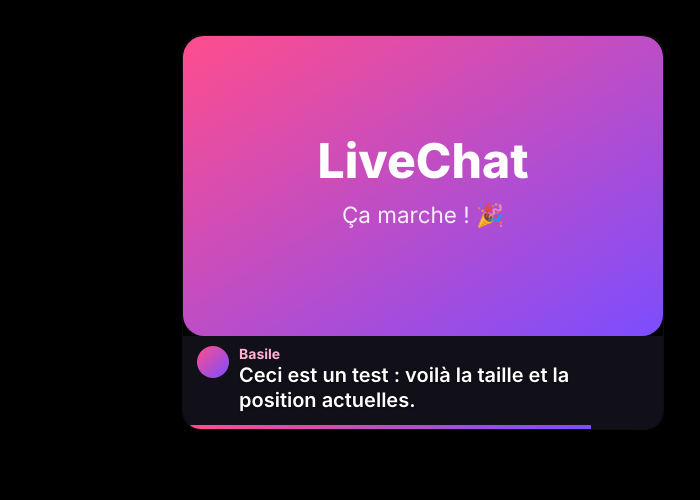
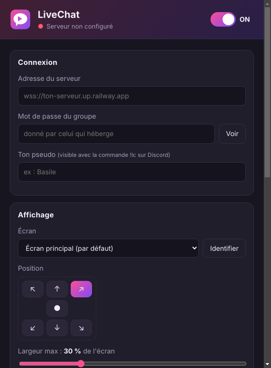

# LiveChat 📺

Un petit logiciel pour rigoler entre potes : quand quelqu'un poste une image, un gif ou une vidéo (avec ou sans texte) dans un salon Discord dédié, **ça pop directement sur l'écran de tous les amis connectés** pendant quelques secondes.

Ce n'est pas un overlay de stream : c'est une appli de bureau qui affiche le média par-dessus tout ce que tu fais (jeu, navigateur…), sans bloquer la souris.

<p align="center">
  
  &nbsp;
  
</p>

## Ce que fait l'appli

- 🖼️ Images, gifs (y compris les liens Tenor/Giphy), vidéos, stickers, sons, et messages texte.
- 🖥️ **Choix de l'écran** pour ceux qui en ont plusieurs (bouton « Identifier » pour savoir qui est qui).
- 📐 **Taille max réglable** (en % de l'écran) et **position** (coins, centre…), pour ne jamais prendre tout l'écran.
- ⌨️ **Raccourcis clavier globaux**, qui marchent même en jeu :
  - `Alt + Shift + H` : fait disparaître tout de suite ce qui s'affiche (et vide la file d'attente).
  - `Alt + Shift + L` : **ON/OFF** de la réception.
  - Les deux sont modifiables dans les paramètres.
- 🔴 **Interrupteur ON/OFF** (dans les paramètres et en clic droit sur l'icône près de l'horloge) : idéal quand tu es en live ou que tu ne veux pas être dérangé.
- ⏱️ Texte seul : 3 s. Images et gifs : 5 s. Vidéos : jouées en entier, avec le son (volume réglable).
- 🙈 **Anti-spoil** : le bot supprime le message du salon dès qu'il est envoyé aux potes. Le serveur garde une copie du média 15 minutes pour que tout le monde puisse le voir.
- 🔒 Les clics passent à travers l'image, et l'appli n'affiche que des médias hébergés par Discord (pas de lien vers des sites inconnus).

Sur Discord, tape `!lc` dans le salon pour voir qui est connecté.

### La fenêtre LiveChat

Une seule fenêtre au style « verre liquide », avec trois pages dans la barre de gauche, et l'interrupteur **Réception** toujours visible en bas :

- **Amis** : qui est en ligne, en temps réel. Pour chaque pote : s'il **reçoit** (point vert) ou a **coupé la réception** (point rouge), s'il a **tout masqué** récemment avec le raccourci, s'il est en mode LITE, s'il refuse les envois placés, son écran, depuis quand il est connecté et sa version. Le bouton « Envoyer à … » ouvre l'envoi avec ce pote déjà coché. Un point gris veut dire qu'il a une ancienne version de l'appli (statut inconnu) : il doit installer la dernière.
- **Envoyer** : l'envoi depuis l'appli (voir plus bas).
- **Réglages** : serveur, compte Discord, écran, taille, raccourcis, mode LITE…

### Mode LITE

Dans **Réglages > Performances**, le mode LITE rend l'appli plus légère en arrière-plan : pas d'accélération graphique permanente, moins de mémoire réservée, la couche d'affichage est fermée quand rien ne s'affiche, et plus d'animations ni d'effets de verre. Redémarre LiveChat après l'avoir activé. Pour info, au repos : environ 490 Mo en mode normal contre 390 Mo en LITE.

### Envoyer depuis l'appli (placement au pixel près)

Page **Envoyer** de la fenêtre LiveChat (ou clic droit sur l'icône > **Envoyer quelque chose…**). Ça ne passe pas par Discord :

- **Média** : un fichier (bouton, glisser-déposer, ou Ctrl+V pour coller une image), ou un lien (gif Tenor/Klipy/Giphy, image, vidéo). Un **PNG transparent** marche très bien.
- **Destinataires** : coche les potes connectés (toi aussi, pour tester), ou « Tout le monde ».
- **Placement précis** : l'aperçu montre l'écran du destinataire à l'échelle, avec sa vraie résolution. Glisse pour déplacer, tire les poignées pour redimensionner, ou tape les valeurs exactes en pixels. Il y a un aimant sur le centre et les bords (maintiens Alt pour l'enlever), les flèches déplacent de 1 px (Maj : 10 px), et des boutons « Centrer », « Taille d'origine » et « Plein écran ».
- **Sans cadre ni texte** : juste l'image, sans pseudo ni bordure. Exemple : un crosshair débile de 64×64 pile au centre de l'écran d'un pote sur Valorant.
- **Anonyme** : cache qui l'envoie. **Durée** : de 1 à 60 s, et les vidéos peuvent être jouées en entier.

Les envois placés s'affichent tout de suite, en même temps que les autres pops. Chacun peut les refuser dans ses paramètres (« Accepter les envois placés »), et le raccourci « masquer » les fait disparaître aussi.

Si plusieurs destinataires ont des résolutions différentes, l'élément garde la même position et la même taille **relatives** à leur écran.

### Envoi privé avec @mention

Si ton message contient des **@mentions**, il ne s'affiche **que chez les personnes mentionnées** (les @ sont retirés du texte affiché). Sans @, il part chez tout le monde.

Pour ça, chacun lie une fois son appli à son compte Discord : dans les paramètres de l'appli, section **Compte Discord**, copie la commande affichée (ex : `!lier 482913`) et colle-la dans le salon live chat. Le bot répond ✅ puis efface la commande. C'est retenu pour la suite.

Si personne parmi les mentionnés n'a l'appli ouverte et liée, le bot te prévient avec un petit message qui s'efface tout seul.

## Comment ça marche

```
 Salon Discord  ──►  Serveur (bot Discord + relais)  ──►  Appli LiveChat chez chaque pote
  "#livechat"         hébergé en ligne, 24h/24              (Windows / Mac / Linux)
```

Il y a **un seul serveur** pour tout le groupe, installé par une personne (toi). Les autres installent juste l'appli. Personne n'a besoin de laisser son PC allumé.

---

## Partie 1 : créer le bot Discord (une seule fois, 5 minutes)

1. Va sur le [Discord Developer Portal](https://discord.com/developers/applications) et clique **New Application**. Donne-lui un nom (ex : `LiveChat`).
2. Dans le menu de gauche, onglet **Bot** :
   - Clique **Reset Token**, puis copie le token et garde-le de côté. ⚠️ Ne le partage jamais : c'est le mot de passe du bot.
   - Plus bas, dans **Privileged Gateway Intents**, active **MESSAGE CONTENT INTENT** et enregistre.
3. Onglet **OAuth2** puis **URL Generator** :
   - Coche `bot` dans *Scopes*.
   - Dans *Bot Permissions*, coche `View Channels`, `Read Message History`, `Send Messages` et `Manage Messages` (pour supprimer les messages après envoi).
   - Ouvre l'URL générée en bas et ajoute le bot à ton serveur Discord.
4. Crée un salon texte dédié, par exemple `#livechat`.
5. Récupère l'**ID du salon** : dans Discord, *Paramètres utilisateur > Avancés > Mode développeur* (à activer), puis clic droit sur le salon > **Copier l'identifiant du salon**.
6. Invente un **mot de passe du groupe** (au moins 8 caractères, ex : `pizza-ananas-2026`). Tu le donneras à tes potes pour qu'ils se connectent.

Tu as maintenant les 3 infos dont le serveur a besoin :

| Réglage | C'est quoi |
|---|---|
| `DISCORD_TOKEN` | le token du bot (étape 2) |
| `CHANNEL_IDS` | l'ID du salon (étape 5). Plusieurs salons possibles, séparés par des virgules |
| `ACCESS_KEY` | le mot de passe du groupe (étape 6) |

## Partie 2 : héberger le serveur en ligne

### Option A (conseillée) : Railway, le plus simple

Pas de ligne de commande, tout se fait sur le site. Compte environ 5 $/mois (formule Hobby), largement suffisant.

1. Crée un compte sur [railway.com](https://railway.com) en te connectant avec GitHub.
2. **New Project** > **Deploy from GitHub repo** > choisis ce dépôt (`brlgchat`). Autorise Railway à le lire si on te le demande.
3. Clique sur le service créé, puis :
   - **Settings > Source > Root Directory** : mets `server`. Railway trouve alors le `Dockerfile` tout seul.
   - **Variables** : ajoute `DISCORD_TOKEN`, `CHANNEL_IDS` et `ACCESS_KEY` avec tes valeurs.
   - **Settings > Networking > Generate Domain** : Railway te donne une adresse du type `brlgchat-production.up.railway.app`. Si on te demande un port, mets `8080`.
4. Attends que le déploiement soit vert. Dans **Deployments > View logs**, tu dois voir :
   ```
   [relais] en écoute sur le port 8080
   [bot] connecté en tant que LiveChat#1234, salon(s) écouté(s) : ...
   ```
5. Ouvre l'adresse dans ton navigateur : tu dois lire `LiveChat relais OK`.

L'**adresse du serveur** à donner à tes potes est alors : `wss://brlgchat-production.up.railway.app` (avec ton domaine à toi).

Chaque fois que tu pousses une modification sur GitHub, Railway redéploie tout seul.

### Option B : gratuit, sur un petit serveur Linux (VPS)

Si tu as un VPS (Oracle Cloud Free Tier, un Raspberry Pi, un vieux PC qui reste allumé…) :

```bash
git clone https://github.com/BasiliClaude/brlgchat.git
cd brlgchat/server
cp .env.example .env        # puis remplis DISCORD_TOKEN, CHANNEL_IDS, ACCESS_KEY
docker build -t livechat .
docker run -d --restart unless-stopped --env-file .env -p 8080:8080 --name livechat livechat
```

L'adresse du serveur sera `ws://IP-DU-SERVEUR:8080` (pense à ouvrir le port 8080 dans le pare-feu). Pour du `wss://` chiffré, mets un reverse proxy comme [Caddy](https://caddyserver.com) devant.

### Option C : pour tester sur ton PC

Il faut [Node.js](https://nodejs.org) 18 ou plus.

```bash
cd server
cp .env.example .env        # puis remplis les 3 valeurs
npm install
npm start
```

L'adresse sera `ws://localhost:8080` (pour toi seulement).

## Partie 3 : installer l'appli (toi et tes potes)

### Récupérer l'installeur

Les installeurs sont construits automatiquement par GitHub :

1. Onglet **Actions** du dépôt > **Construire l'appli** > **Run workflow**. Au bout de 5 à 10 minutes, les fichiers sont dans la section *Artifacts* en bas de la page du run.
2. Ou crée un tag de version (`git tag v1.0.0 && git push --tags`) : une **Release** apparaît avec les installeurs.

> Le dépôt est privé, donc tes potes ne peuvent pas télécharger depuis GitHub. Le plus simple : envoie-leur le fichier `LiveChat-Setup-x.y.z.exe` directement sur Discord. (Rien de secret n'est stocké dans le code, tu peux aussi rendre le dépôt public si tu préfères.)

### Installer

- **Windows** : lance `LiveChat-Setup-x.y.z.exe`. Windows peut afficher « Windows a protégé votre ordinateur » parce que l'appli n'est pas signée (un certificat coûte cher) : clique **Informations complémentaires** puis **Exécuter quand même**.
- **Mac** : ouvre le `.dmg` et glisse LiveChat dans Applications. Au premier lancement, fais **clic droit > Ouvrir** (l'appli n'est pas signée).
- **Linux** : rends le `.AppImage` exécutable (`chmod +x`) et lance-le.

### Configurer

Au premier lancement, la page Réglages s'ouvre :

1. **Adresse du serveur** : `wss://…` (donnée par celui qui héberge).
2. **Mot de passe du groupe** : le `ACCESS_KEY`.
3. **Ton pseudo** : pour que les autres voient que tu es connecté avec `!lc`.
4. La pastille en haut passe au vert « Connecté ». Clique **Tester l'affichage** pour régler l'écran, la position et la taille.

Fermer la fenêtre ne quitte pas l'appli : elle reste dans la barre des tâches, près de l'horloge (clic sur l'icône pour rouvrir la fenêtre sur la page Amis, clic droit pour le menu ON/OFF). Coche « Lancer au démarrage » pour ne plus y penser.

## Bon à savoir

- **Jeux en plein écran exclusif** : certains jeux en « plein écran » pur passent par-dessus toutes les fenêtres. Mets le jeu en **plein écran fenêtré** (ou « sans bordure ») et les pops s'afficheront par-dessus.
- Plusieurs messages d'affilée s'affichent **les uns après les autres** (file d'attente). Le raccourci « masquer » vide la file.
- Les gifs s'affichent pendant la durée choisie ; les vidéos jusqu'à leur fin, sans dépasser la durée max.
- Quand la réception est sur OFF, tu restes connecté (tes potes voient « réception coupée » dans la page Amis et dans `!lc`), mais le serveur ne t'envoie plus rien : rien d'embarrassant en live.
- Pour vérifier une installation sans serveur, lance l'appli avec la variable `LIVECHAT_DEMO=1` : un pop de test s'affiche au démarrage.

## Développement

```
server/   bot Discord (discord.js) + relais WebSocket (ws)       npm start / npm test
client/   appli Electron                                         npm start / npm run dist
```

- `client/src/main.js` : fenêtre transparente, icône, raccourcis, connexion.
- `client/src/overlay.*` : l'affichage des pops (file d'attente, animations).
- `client/src/settings.*` : la fenêtre de paramètres.
- `server/extract.js` : transforme un message Discord en pop. `server/relay.js` : le relais.
- `client/tools/make-icons.js` régénère les icônes.

Variables optionnelles du serveur :
- `DELETE_MESSAGES=false` : ne plus supprimer les messages du salon (le bot met alors une réaction `ACK_EMOJI`, 📺 par défaut).
- `ALLOW_TEXT_ONLY=false` : ignorer les messages sans média.
- `MEDIA_MAX_MB=200` : taille max d'un média copié par le serveur.

Gifs par lien : Tenor, Giphy, Klipy, Imgur et GifDB marchent. Si Discord n'affiche pas d'aperçu, le serveur lit lui-même la page du lien.

### Si le bot ne supprime pas les messages

Il lui manque la permission **Gérer les messages**. Sur Discord : clic droit sur le salon > *Modifier le salon* > *Permissions* > ajoute le rôle du bot > coche **Gérer les messages** > *Enregistrer*. Le message `Impossible de supprimer` apparaît aussi dans les logs Railway.
